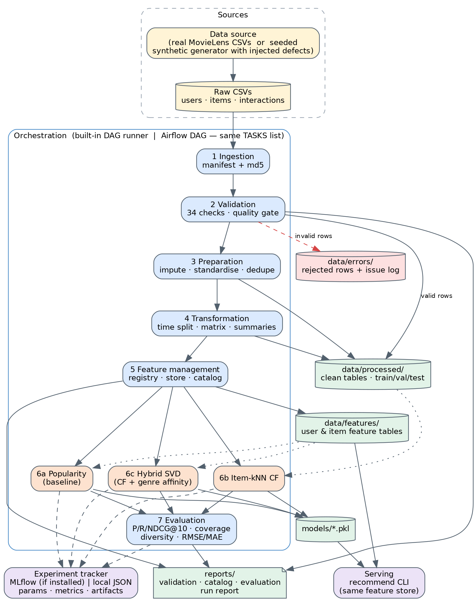

# End-to-End Data Management Pipeline for a Recommendation System

> **Fastest path:** real MovieLens 1M from scratch -> see [`QUICKSTART.md`](QUICKSTART.md). One-time machine setup (WSL2, Python, installs) -> [`SETUP_GUIDE.md`](SETUP_GUIDE.md).

DMML Assignment 2 — movie recommender with a reproducible, orchestrated pipeline built on the standard tools:

| Concern | Tool |
|---|---|
| Data validation | **Great Expectations** (GX Core 1.x) |
| Feature management | **Feast** (registry, point-in-time offline retrieval, SQLite online store) |
| Models | popularity baseline · item-kNN CF · hybrid SVD · **scikit-surprise** SVD |
| Experiment tracking | **MLflow** |
| Orchestration | **Apache Airflow** (a small built-in runner is also included for quick local runs) |
| Storage | **Parquet** (raw inputs stay CSV, the source format) |

`Ingestion → Validation → Preparation → Transformation → Feature Management → Training (4 models) → Evaluation`



> **Verified status.** The full pipeline (all 10 tasks, 4 models) has been run end to end with the real tools - Great Expectations 1.24.1, Feast, scikit-surprise,
> MLflow 2.22.5, Parquet storage and Apache Airflow 2.10.5 (WSL2 / Ubuntu 22.04, Python 3.11) - on the synthetic dataset and on MovieLens 1M.
> The repository ships **without generated outputs** (data, models, reports, MLflow runs): running the pipeline creates them.
> `configs/config.fallback.yaml` (CSV, lightweight validation, no Feast/Surprise) exists only for quick checks and for the unit tests.

## One-command run (after the one-time setup below)
```bash
source .venv/bin/activate
bash scripts/run_all.sh        # smoke check -> clean -> synthetic run -> MovieLens 1M download + run -> diagram, screenshots, reports  (~15-20 min)
bash scripts/run_airflow.sh    # the DAG once under real Airflow (needs the Airflow venv from step 5); then take the Airflow screenshot (step 6)
bash scripts/build_reports.sh  # rebuild the final report PDF(s) after the Airflow screenshot is saved
```
`scripts/clean_outputs.sh` deletes all generated outputs (keeps code and both virtualenvs). See [`QUICKSTART.md`](QUICKSTART.md) for the details.

---------------------------------------------------------------------------------------------------

## Setup and execution

### 0. Prerequisites
* **Python 3.11** (recommended; 3.12+ may lack prebuilt wheels for scikit-surprise/Feast).
* Git, ~2 GB disk. A **C compiler** only if scikit-surprise has to build from source (see troubleshooting).
* **Airflow needs Linux/macOS.** On Windows use **WSL2** (Ubuntu) for the whole project. **Full click-by-click guide (installing WSL2, Python 3.11, downloading MovieLens, running everything, Airflow screenshot): see [`SETUP_GUIDE.md`](SETUP_GUIDE.md).**

### 1. Create the project environment
```bash
cd recommendation-pipeline
python3.11 -m venv .venv
source .venv/bin/activate            # Windows (PowerShell, no Airflow): .venv\Scripts\Activate.ps1
python -m pip install --upgrade pip
pip install "numpy<2" "cython<3"
pip install --no-build-isolation scikit-surprise   # install order avoids the common build failure
pip install -r requirements.txt
```
If scikit-surprise fails to build, see Troubleshooting below.

### 2. (optional) browser for the screenshot script
```bash
playwright install chromium
```

### 3. Verify every tool works here — do this before the full run
```bash
python scripts/smoke_check.py            # add VERBOSE=1 for tracebacks
```
Expected: `OK` for parquet, Great Expectations, Feast, scikit-surprise, MLflow and the unit tests (Airflow shows FAIL here — it lives in its own env).
If a line says FAIL, run `VERBOSE=1 python scripts/smoke_check.py` for the traceback; library APIs change between minor versions and the pins in `requirements.txt` may need adjusting.

### 4. Run the whole pipeline (no Airflow yet)
```bash
python run_pipeline.py                   # a few minutes; synthetic data is generated on first run
python -m pytest -q -rs tests            # tests that need a missing library are reported as skipped
```
Look at the results:
```bash
cat reports/model_evaluation.md          # model comparison table
head -30 reports/validation_report.md    # Great Expectations results (engine line at top shows the GX version)
mlflow ui --backend-store-uri ./mlruns   # http://127.0.0.1:5000  -> experiment "recsys-pipeline", one run per model
python -m src.training.recommend --user 17 --k 10 --model hybrid_svd   # served with Feast ONLINE features
```
Other options: `--list`, `--start-from prepare`, `--only evaluate`, `--regenerate-data`.
**Real MovieLens instead of synthetic data: see the section "Using real MovieLens data" below.**

### 5. Install Airflow in its OWN virtualenv (it conflicts with the ML stack's pins)
```bash
deactivate 2>/dev/null
python3.11 -m venv .venv-airflow && source .venv-airflow/bin/activate
AIRFLOW_VERSION=2.10.5; PYTHON_VERSION=3.11
pip install -r requirements-airflow.txt \
  --constraint "https://raw.githubusercontent.com/apache/airflow/constraints-${AIRFLOW_VERSION}/constraints-${PYTHON_VERSION}.txt"
```

### 6. Run the DAG in Airflow
```bash
export RECSYS_HOME="$(pwd)"                              # project root
export RECSYS_PYTHON="$(pwd)/.venv/bin/python"           # python of the PROJECT venv (step 1), not the Airflow one
export AIRFLOW_HOME="$(pwd)/.airflow"
export AIRFLOW__CORE__DAGS_FOLDER="$(pwd)/dags"
export AIRFLOW__CORE__LOAD_EXAMPLES=False

airflow db migrate                                       # one-time: creates the Airflow metadata database
airflow dags list-import-errors                          # must print "No data found"
airflow dags test recommendation_pipeline 2026-01-01     # runs the full DAG once in the terminal; ends with state=success

airflow standalone                                       # UI at http://localhost:8080 (login printed in the terminal)
```
In the UI: un-pause `recommendation_pipeline` → **Trigger** → open **Graph** view → when all nodes are green take the
screenshot (click the newest run in the grid first so the boxes are coloured) → save it as `reports/figures/airflow_successful_run.png` (for the MovieLens report: `reports/movielens1m/figures/`). (`airflow dags trigger recommendation_pipeline` also works.) `RECSYS_CONFIG` (see the MovieLens section) selects which dataset/config the DAG runs on; `scripts/run_airflow.sh` does the exports, migration, import check and test run for you.
Each Airflow task simply runs `python -m src.orchestration.cli run-task <name>` in the project venv, so results are identical to step 4.

### 7. Regenerate the final report PDF from your own run
```bash
source .venv/bin/activate
python scripts/make_architecture.py && python scripts/make_run_screenshot.py && python scripts/make_final_report.py
```
(`make_run_screenshot.py` captures the built-in runner's report; the Airflow screenshot from step 6 is the one that shows Airflow.)

---------------------------------------------------------------------------------------------------

## Project layout / stages

| Stage | Module | Outputs |
|---|---|---|
| Ingestion | `src/ingestion/` | `data/raw/*.csv`, `manifest.json` (rows, columns, md5) |
| Validation | `src/validation/ge_checks.py` (GX), `checks.py` (fallback + shared `IssueLog`) | `data/errors/rejected_*.parquet`, `validation_issues.{parquet,csv}`, `reports/validation_report.{md,json}`, `data/processed/valid_*.parquet` |
| Preparation | `src/preparation/` | `data/processed/*_clean.parquet`, `preparation_summary.json` |
| Transformation | `src/transformation/` | `train/val/test.parquet`, `user_activity_summary`, `item_popularity`, `user_item_matrix.npz`, `split_info.json` |
| Feature management | `src/features/` (`registry.py`, `feature_store.py`, `feast_layer.py`) | `data/features/*.parquet`, `feature_repo/` (Feast registry + online store), `reports/feature_catalog.{md,csv}` |
| Training | `src/training/` | `models/*.pkl`, `reports/tuning_*.csv`, MLflow runs in `mlruns/` |
| Evaluation | `src/evaluation/` | `reports/model_evaluation.{md,csv,json}`, `figures/model_comparison.png` |
| Orchestration | `dags/recommendation_dag.py`, `src/orchestration/` | Airflow DAG; built-in runner report `reports/run_report.html` |

Design notes
* **Great Expectations**: every rule is a GX Expectation on a pandas batch whose index is the raw file line number, so failed rows trace back to the source file. Severity `error` quarantines a row to `data/errors/`; `warning` keeps it for repair in preparation. A quality gate (`max_error_rate`) fails the run (downstream tasks become `upstream_failed`). `tests/test_real_tools.py` checks that GX and the fallback engine reject exactly the same rows.
* **Feast**: features are computed from the *training period only* (`FeatureStore.fit`), published as Feast feature views (user, item), retrieved for training with point-in-time joins at the split cutoff, and served online from the SQLite online store. A parity check at the end of `build_features` asserts online == offline values (training/serving skew guard). The feature catalog is generated from `registry.py` and checked against the materialised columns.
* **Models**: `popularity` (baseline) · `item_knn` (item–item cosine CF) · `hybrid_svd` (PureSVD + genre-affinity feature blend + biased-SVD rating head) · `surprise_svd` (scikit-surprise SVD; ranks by predicted rating). Hyper-parameters are tuned on a validation slice (`train_core → val`), then refit on all pre-test data. Test data is only touched in evaluation.
* **Split**: chronological — newest 20 % of interactions = test, previous 10 % = validation.
* **Evaluation**: Precision@10, Recall@10, NDCG@10, catalogue coverage, intra-list genre diversity; RMSE/MAE for models with a rating head.
* **MLflow**: params, metrics and artifacts (pickle, tuning grid, metrics JSON) per model run. Use `tracking.mlflow_uri: http://127.0.0.1:5000` after `mlflow server` if you prefer a server.

## Using real MovieLens data

The default run uses a synthetic dataset. To run the **same pipeline on real MovieLens** (GroupLens). **MovieLens 1M is the recommended headline dataset** - the time-based test period holds ~1,100 users, versus only ~28 for `ml-latest-small`:

```bash
source .venv/bin/activate
python scripts/prepare_movielens.py --dataset ml-1m --out data/movielens1m/raw      # ~6 MB download, 1M ratings, 6,040 users, 3,883 movies
python run_pipeline.py --config configs/config.movielens1m.yaml                      # own folders: data/movielens1m, models/movielens1m, reports/movielens1m; MLflow experiment recsys-movielens-1m
cat reports/movielens1m/model_evaluation.md
python scripts/make_run_screenshot.py reports/movielens1m
python scripts/make_final_report.py reports/movielens1m data/movielens1m/processed
```

The smaller `ml-latest-small` (100k ratings) is also supported and is faster for experiments:

```bash
source .venv/bin/activate

# 1. Download + convert (needs internet; ~1 MB). Writes data/movielens/raw/{users,items,interactions}.csv
python scripts/prepare_movielens.py --dataset ml-latest-small      # 100k ratings, 610 users, 9.7k movies  (fast, but only ~28 test users)
#   or: --dataset ml-1m        # 1M ratings, 6k users, 3.7k movies; includes gender + age bracket (slower: Great Expectations on 1M rows takes minutes)

# 2. Run the pipeline with the MovieLens config
python run_pipeline.py --config configs/config.movielens.yaml

# 3. Look at the results / serve recommendations
cat reports/movielens/model_evaluation.md
mlflow ui --backend-store-uri ./mlruns                              # experiment "recsys-movielens"
python -m src.training.recommend --config configs/config.movielens.yaml --user 1 --k 10 --model hybrid_svd

# 4. Report + screenshot for the MovieLens run
python scripts/make_run_screenshot.py reports/movielens
python scripts/make_final_report.py reports/movielens data/movielens/processed
```

**Manual download** (if the script cannot reach the internet): get `ml-latest-small.zip` from <https://grouplens.org/datasets/movielens/latest/>
(or `ml-1m.zip` from <https://grouplens.org/datasets/movielens/1m/>) in your browser, then
`python scripts/prepare_movielens.py --zip ~/Downloads/ml-latest-small.zip` (or `--dir <extracted folder>`).
Supported layouts: `ratings.csv + movies.csv` (ml-latest-small, ml-latest, ml-25m — 25m is far too large for this pipeline) and `ratings.dat + movies.dat + users.dat` (ml-1m).

**Airflow on MovieLens:** the DAG reads the config path from `RECSYS_CONFIG`; set it before starting Airflow:
`export RECSYS_CONFIG="$(pwd)/configs/config.movielens.yaml"` (or `config.movielens1m.yaml`). `scripts/run_airflow.sh` defaults to the MovieLens 1M config.

What the converter and `config.movielens.yaml` take care of
* Maps MovieLens columns to the pipeline schema; epoch timestamps → `YYYY-MM-DD HH:MM:SS`; release year parsed from `Title (1995)`; `(no genres listed)` → missing genres (reported as a warning, imputed as `Unknown`).
* **Users:** ml-latest-small has no user table, so `user_id` and `signup_date` (= first rating date) are derived and age/gender/country are empty (validation reports warnings, preparation imputes). ml-1m provides gender and an age *bracket* (stored as the bracket midpoint). Country is never available.
* `config.movielens.yaml` inherits everything from `config.yaml` (`extends:`) and only changes: source = CSV, `min_valid_date: 1990-01-01` (the synthetic default of 2015 would reject all 1990s ratings), a separate set of folders (`data/movielens/`, `models/movielens/`, `reports/movielens/`), its own Feast repo and MLflow experiment — so synthetic and MovieLens runs never mix.
* The genre list (`genre_vocabulary` in `config.yaml`) already covers MovieLens genres (Children, Film-Noir, IMAX, …).
* Item-kNN builds its similarity matrix in chunks, so ~10k movies fit in memory.
* The converter and the MovieLens code path are covered by unit tests on mock files in both real layouts, and have been run end to end on the downloaded `ml-latest-small` and `ml-1m` data.

MovieLens data is © GroupLens Research: free for research/education, **not** to be redistributed (so it is not included here). Cite: F. M. Harper & J. A. Konstan, "The MovieLens Datasets: History and Context", ACM TiiS 5(4), 2015.

## Synthetic data (default)
A **seeded synthetic MovieLens-style dataset** is generated on first run (2,000 users, 900 movies, ~60k ratings, ~8 % deliberately corrupted rows; see `src/ingestion/generate_synthetic.py` and `data/raw/synthetic_generation_log.json`). To bring your own CSVs instead, set `ingestion.source: csv` and place `users.csv`, `items.csv`, `interactions.csv` (columns in `src/ingestion/ingest.py`) in `data/raw/`.

## Troubleshooting
| Symptom | Fix |
|---|---|
| `scikit-surprise` fails to build | Linux: `sudo apt install build-essential python3.11-dev`; macOS: `xcode-select --install`; Windows: use WSL2 or `conda install -c conda-forge scikit-surprise` in a conda env. Last resort: set `models.surprise_svd.enabled: false` in `configs/config.yaml` (the DAG then skips that task). |
| pip dependency conflict | Run `pip install -r requirements.txt` in a *fresh* Python 3.11 venv; if it persists, the resolver message names the conflicting pins to adjust in `requirements.txt`. |
| `smoke_check` FAIL on Great Expectations / Feast | Run `VERBOSE=1 python scripts/smoke_check.py` and send the traceback — GX/Feast APIs change between minor versions and the pins in `requirements.txt` can be adjusted. |
| Airflow DAG import error | `airflow dags list-import-errors`; check `RECSYS_HOME` is exported *in the shell that starts Airflow*. |
| MovieLens run rejects almost every rating | You ran the default config on MovieLens: use `--config configs/config.movielens.yaml` (it lowers `min_valid_date`). |
| `scripts/prepare_movielens.py` cannot download | Download the zip in a browser and use `--zip` (see above). |
| Airflow task fails immediately | `RECSYS_PYTHON` must point to the **project** venv python (has pandas, feast, …), not the Airflow venv. |
| `zip` / `pdftotext` not found (Ubuntu) | `sudo apt install -y zip poppler-utils` |
| MLflow shows the same experiment name several times | Old data from before the tracker used a lock: stop the MLflow UI, `rm -rf mlruns`, re-run the pipeline. |
| MLflow rejects a metric name containing `@` | Handled: the tracker stores `ndcg@10` as `ndcg_at_10` in MLflow. |
| `make_run_screenshot.py` fails | Needs `playwright install --with-deps chromium` (step 2). The rest of the pipeline does not need it. |
| `make_architecture.py`: `dot` not found | `sudo apt install -y graphviz` |
| Start over | `bash scripts/clean_outputs.sh` (add `--airflow` to reset the Airflow database too). Never delete `.venv` / `.venv-airflow` - reinstalling takes long. |
| Need the pipeline without the extra tools | `python run_pipeline.py --config configs/config.fallback.yaml` (CSV, lightweight validation, no Feast/Surprise, local MLflow-less tracker). For quick checks only. |

## Limitations
Single chronological split with no confidence intervals (on `ml-latest-small` only ~28 users fall in the test period, so use `ml-1m` for headline numbers); Surprise SVD ranks by predicted rating, which is known to be weaker for top-N than ranking-optimised models; cold-start users get a popularity fallback and are excluded from ranking metrics; on MovieLens 1M the tuned hybrid selects `alpha=0` (the genre-content blend does not help there); item-kNN similarity is chunked and sparse (handles a few thousand items here) but scoring uses dense users x items blocks, so very large catalogues need approximate neighbour search; MovieLens has no country field and (in `ml-latest-small`) no demographics.
